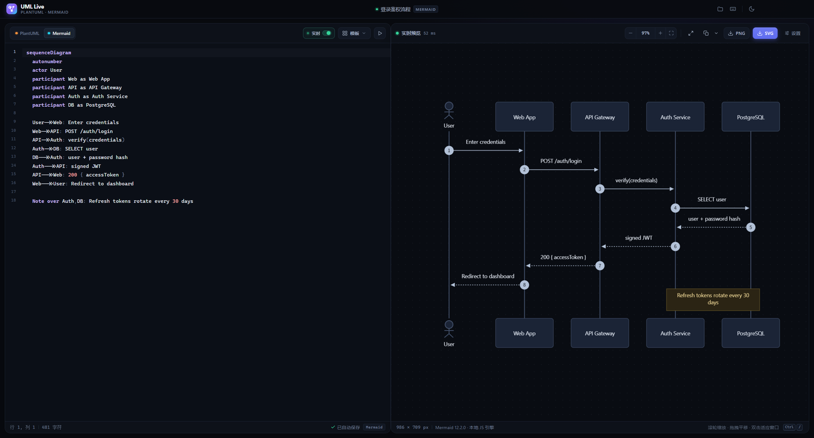
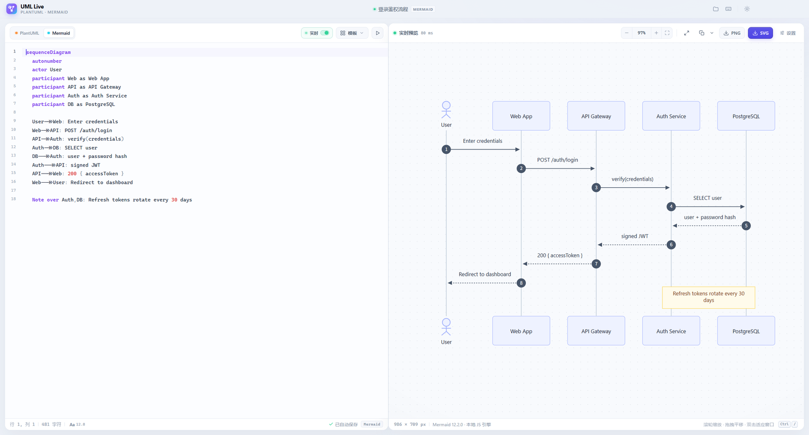
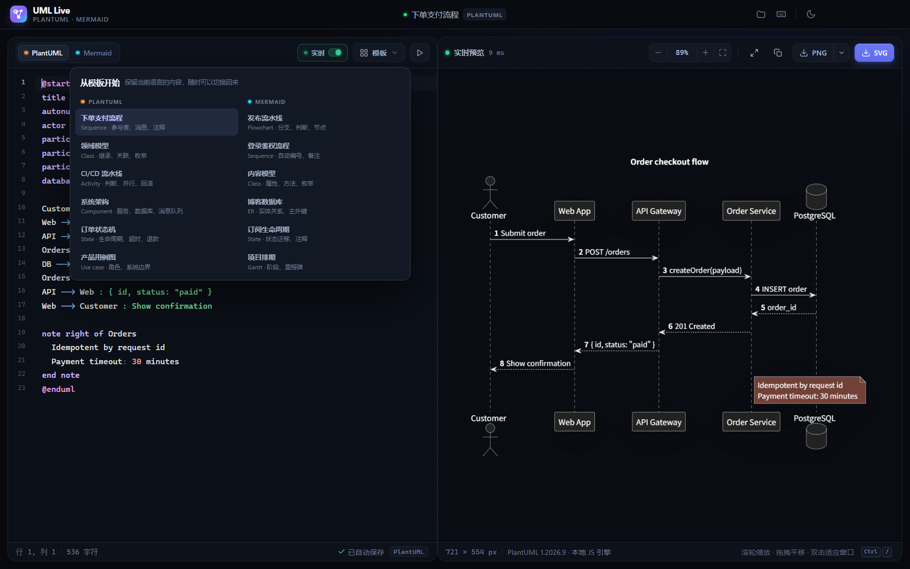
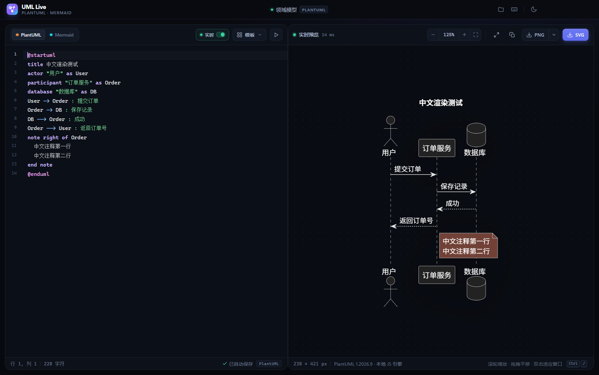
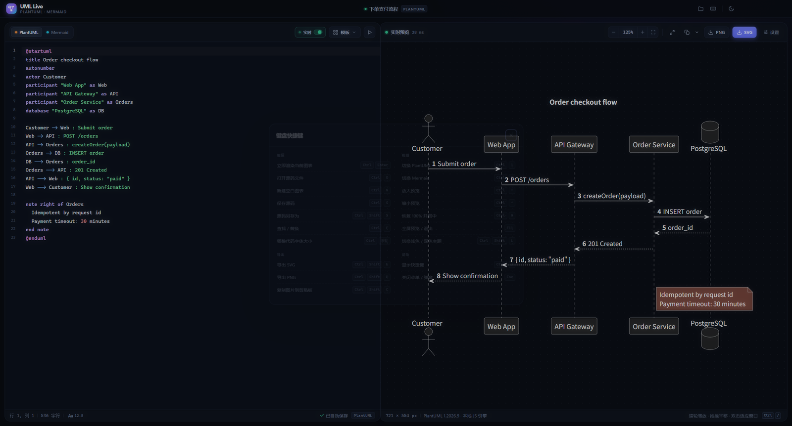
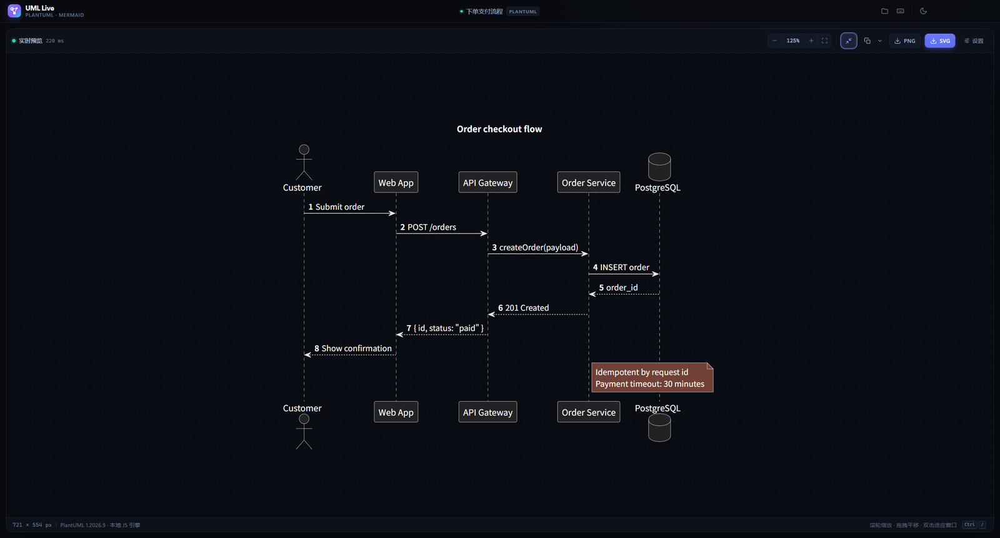
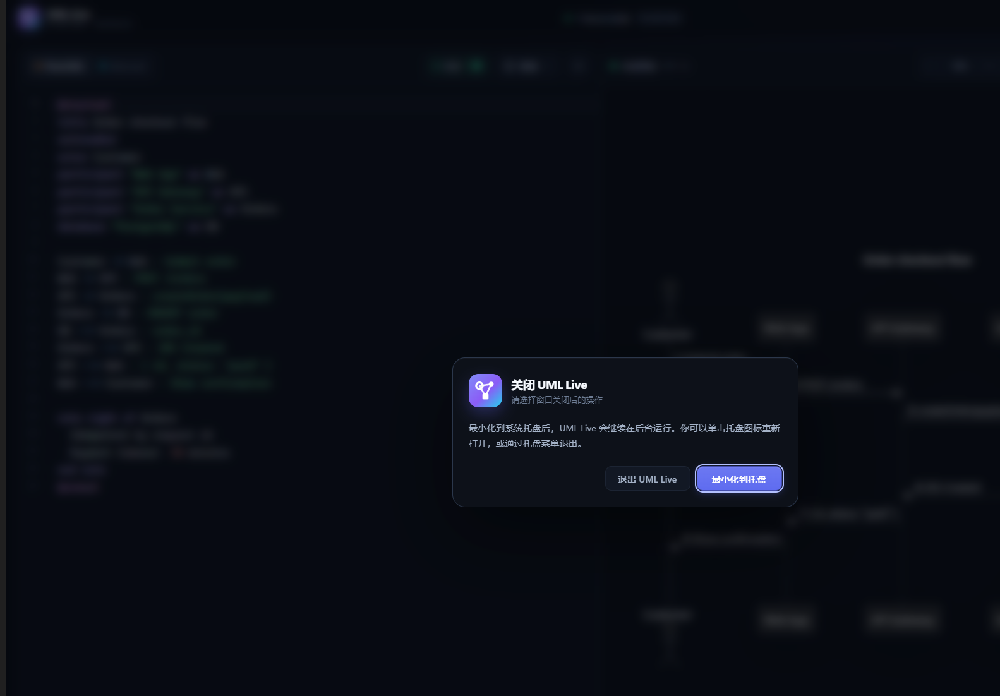

# UML Live

**面向 Windows 的 PlantUML / Mermaid 实时预览器。**
左侧写代码，右侧即时出图；核心渲染与导出完全在本地用 JavaScript 完成，不需要安装 Java、Graphviz，也不需要渲染服务器。



## 目录

- [功能特性](#功能特性)
- [截图](#截图)
- [快速开始](#快速开始)
- [使用指南](#使用指南)
- [技术架构](#技术架构)
- [开发与构建](#开发与构建)
- [常见问题](#常见问题)
- [已知限制](#已知限制)
- [安全与隐私](#安全与隐私)
- [许可证与致谢](#许可证与致谢)

## 功能特性

- **双引擎实时渲染**：PlantUML 与 Mermaid 各自拥有独立源码；停止输入约 360ms 后自动刷新预览，也可以按 `Ctrl+Enter` 手动刷新。
- **纯 JavaScript 的 PlantUML**：使用 PlantUML 官方发布的 [`@plantuml/core`](https://www.npmjs.com/package/@plantuml/core) TeaVM JavaScript 构建；Graphviz 布局由 [Viz.js](https://github.com/mdaines/viz-js) 的 WebAssembly 版本提供。
  **没有 Java、`plantuml.jar`、本地服务端进程，也不请求 plantuml.com。**
- **Mermaid 12**：本地打包的 Mermaid 12.2 渲染器，覆盖流程图、时序图、类图、ER、状态图、甘特图、思维导图等常用图表。
- **面向开发的编辑器**：CodeMirror 6、行号、PlantUML / Mermaid 语法高亮、自动换行、搜索替换、撤销历史。
- **可操作的预览**：鼠标滚轮直接缩放、拖拽平移、一键恢复 100% 并居中、双击适应窗口。
- **全屏预览**：预览工具栏新增展开按钮，一键收起代码区，让图表占满工作区；按 `F11` 或 `Esc` 恢复。
- **系统托盘**：关闭窗口时弹出与应用同主题的确认对话框，可选择最小化到托盘（默认）或退出；托盘菜单支持重新打开与退出。
- **浅色 / 深色主题**：应用界面与图表同步切换，标题栏原生控件颜色也会同步。
- **导出与复制**：
  - 导出 SVG 矢量图，默认纯白背景，也可以在导出设置中改为透明；
  - 导出 PNG，支持 1× / 2× / 3×，默认纯白背景，可选透明背景；
  - 一键复制 PNG 图片到 Windows 剪贴板，默认同样使用纯白背景；
  - 复制 SVG 源码（矢量），可粘贴到代码编辑器，或保存为 `.svg` 后导入设计工具。
- **效率细节**：12 个内置模板、文件打开 / 保存、拖拽 `.puml` / `.mmd` 文件、源码自动保存、窗口位置记忆、完整快捷键面板。
- **错误反馈**：语法错误时保留上一次成功预览并叠加错误面板；PlantUML / Mermaid 错误会尽量提取行号和原始信息。
- **安全默认值**：渲染进程开启 `sandbox` 与 `contextIsolation`，关闭 `nodeIntegration`，使用 CSP 与白名单 IPC。

## 截图

| 浅色主题 | 模板菜单 |
| --- | --- |
|  |  |

| 中文 PlantUML | 快捷键面板 |
| --- | --- |
|  |  |



## 快速开始

### 直接使用

当前工作区已生成 v1.0.0 的 Windows x64 构建产物：

| 文件 | 说明 |
| --- | --- |
| [`release/UML Live-Setup-1.0.0.exe`](<release/UML Live-Setup-1.0.0.exe>) | NSIS 安装包，可选择安装目录并创建桌面 / 开始菜单快捷方式 |
| [`release/UML Live-Portable-1.0.0.exe`](<release/UML Live-Portable-1.0.0.exe>) | 免安装便携版，双击运行 |
| [`release/SHA256SUMS.txt`](<release/SHA256SUMS.txt>) | 安装包 SHA-256 校验值 |

系统要求：**Windows 10 / 11（x64）**。安装版和便携版运行时都不需要 Java、Node.js 或其他渲染服务。

> `release/` 未被提交到版本库。如果克隆仓库后没有该目录，请执行 `npm run dist` 重新生成，
> 或直接按下文的“从源码运行”启动。

> 这些发行包由本地构建，**未做代码签名**。首次运行时 Windows SmartScreen 可能提示
> “Windows 已保护你的电脑”，选择“更多信息 → 仍要运行”即可。正式分发建议使用你自己的代码签名证书。

执行 `npm run pack` 还会生成 `release/win-unpacked/UML Live.exe` 解包版，适合调试或直接分发目录。

### 从源码运行

需要 **Node.js 22.12+（推荐 24）** 和 **npm 10+**：

```powershell
# 安装依赖；postinstall 会自动把 PlantUML 运行时复制到 public/
npm install

# Vite HMR + Electron 开发窗口
npm run dev

# 构建前端后，以生产模式启动
npm start
```

首次安装时，`postinstall` 会从 `node_modules/@plantuml/core` 复制 PlantUML 运行时到 `public/`。
如果自动复制被跳过，可以手动执行：

```powershell
npm run assets
```

如果 Electron 二进制或 electron-builder 工具下载缓慢，可以先设置镜像：

```powershell
$env:ELECTRON_MIRROR = "https://npmmirror.com/mirrors/electron/"
$env:ELECTRON_BUILDER_BINARIES_MIRROR = "https://npmmirror.com/mirrors/electron-builder-binaries/"
npm install
npm run dist
```

## 使用指南

### 语言与渲染

- 编辑器左上角切换 **PlantUML / Mermaid**；两种语言的源码、文件路径和编辑内容相互独立。
- 右上「实时」开关控制自动渲染。关闭后按 `Ctrl+Enter` 或点击 ▶ 手动渲染。
- 顶部文件夹菜单支持：新建空白图表、打开源码、保存源码、另存为。
- 可以直接把 `.puml` / `.plantuml` / `.mmd` / `.mermaid` / `.txt` 文件拖进窗口打开。
- 点击预览工具栏的展开按钮或按 `F11` 进入全屏预览，收起代码区；再次点击、`F11` 或 `Esc` 恢复。
- `samples/` 下提供三个示例：[`order-checkout.puml`](samples/order-checkout.puml)、
  [`login-flow.mmd`](samples/login-flow.mmd)、[`chinese-example.puml`](samples/chinese-example.puml)。

### 导出

- **SVG 矢量图**：顶部「SVG」按钮直接导出矢量文件；默认使用 `#ffffff` 纯白背景，可在导出设置中勾选透明背景。
- **PNG**：点击「PNG」按钮按当前倍率导出，默认纯白背景；PNG 旁 ▾ 菜单可切换 1× / 2× / 3× 与透明背景。
- **复制图片**：按当前 PNG 倍率生成图片并写入 Windows 剪贴板，默认白色背景。
- **复制 SVG 源码**：复制按钮旁 ▾ 菜单提供“复制 SVG 源码（矢量）”，内容包含 `<?xml ...?>` 声明和完整的 SVG 标记，可粘贴到代码编辑器，或保存为 `.svg` 文件后导入设计工具。
- 深色主题下使用白底导出时，会自动按浅色配色重新渲染图表，确保白底上的文字和线条清晰可读。
- 透明背景设置同时作用于 PNG、复制图片和 SVG，并保留当前预览中的图表配色。
- 超大图表会自动限制到约 80MP / 16384px 单边，避免 Canvas 崩溃。

### 预览操作

| 操作 | 方式 |
| --- | --- |
| 缩放 | 鼠标滚轮，或工具栏 `+` / `-` |
| 平移 | 按住鼠标左键拖动 |
| 恢复 100% 并居中 | 点击缩放百分比、工具栏居中按钮，或 `Ctrl+0` |
| 适应窗口 | 双击预览区 |
| 全屏预览 / 退出 | 预览工具栏展开按钮，或 `F11` / `Esc` |
| 重置主题 / 深浅色 | 标题栏太阳/月亮按钮，或 `Ctrl+Shift+L` |

### 快捷键

| 操作 | 快捷键 |
| --- | --- |
| 立即渲染 | `Ctrl + Enter` |
| 打开源码 | `Ctrl + O` |
| 新建空白图表 | `Ctrl + N` |
| 保存源码 / 另存为 | `Ctrl + S` / `Ctrl + Shift + S` |
| 查找 / 替换 | `Ctrl + F` |
| 切换 PlantUML / Mermaid | `Ctrl + 1` / `Ctrl + 2` |
| 放大 / 缩小 / 恢复 100% 并居中 | `Ctrl +` / `Ctrl -` / `Ctrl 0` |
| 全屏预览 / 退出 | `F11` |
| 切换浅色 / 深色 | `Ctrl + Shift + L` |
| 导出 SVG / PNG | `Ctrl + Shift + E` / `Ctrl + Shift + P` |
| 复制图片 | `Ctrl + Shift + C` |
| 快捷键帮助 | `Ctrl + /` |
| 关闭菜单 / 弹窗 | `Esc` |

### 关闭与系统托盘

- 点击窗口关闭按钮或按 `Alt+F4` 时，会弹出与应用界面同主题的关闭确认框，可选择**最小化到系统托盘**（默认）或**退出 UML Live**。
- 选择最小化后，窗口会隐藏，应用继续在后台运行；单击托盘图标重新打开，右键托盘菜单可以显示窗口或退出。
- 在关闭确认框上按 `Esc` 也会按默认选项最小化到托盘。
- 从安装目录或启动器重新打开 UML Live 时，会直接唤回已隐藏在托盘中的窗口。



### 本地草稿与窗口状态

- 正在编辑的源码、语言、主题、模板来源、导出倍率、分栏比例保存在本机 `localStorage`。
- 窗口位置与大小保存在 `%APPDATA%\UML Live\window-state.json`。
- 应用不上传源码，也不包含遥测。卸载或删除 `%APPDATA%\UML Live` 会同时清除本地草稿与窗口状态。

## 技术架构

### 技术栈

| 层面 | 技术 |
| --- | --- |
| 桌面容器 | Electron 45 |
| 前端构建 | Vite 8 |
| 代码编辑器 | CodeMirror 6 + 自定义 StreamLanguage 语法高亮 |
| PlantUML | `@plantuml/core` 1.2026.9（TeaVM JavaScript 引擎） |
| Graphviz 布局 | Viz.js 3.24（WebAssembly，随应用本地加载） |
| Mermaid | Mermaid 12.2.0 |
| PNG 导出 | Chromium Canvas 矢量重新栅格化 |
| Windows 打包 | electron-builder 26（NSIS + Portable） |
| 冒烟测试 | Node.js + Chrome DevTools Protocol |

### 项目结构

```text
.
├─ electron/
│  ├─ main.js          窗口、托盘、uml-live:// 协议、文件/剪贴板 IPC、窗口状态
│  └─ preload.cjs      最小 contextBridge，只暴露白名单 API
├─ src/
│  ├─ index.html       应用外壳与 SVG 图标 sprite
│  ├─ styles.css       深色 / 浅色设计系统与响应式布局
│  └─ js/
│     ├─ main.js       状态管理、渲染调度、导出、菜单、快捷键、弹窗
│     ├─ editor.js     CodeMirror 6 编辑器封装
│     ├─ highlight.js  PlantUML / Mermaid 流式语法高亮
│     ├─ preview.js    缩放、平移、自适应与 SVG 装配
│     ├─ svg.js        SVG 净化、尺寸测量、PNG 栅格化、背景注入
│     ├─ templates.js  内置模板与语言识别
│     ├─ errors.js     统一渲染错误模型
│     └─ renderers/    PlantUML / Mermaid 渲染适配层
├─ public/             构建时生成的 PlantUML 运行时（勿手改）
├─ scripts/
│  ├─ copy-assets.mjs  从 @plantuml/core 生成 public/ 运行时
│  ├─ dev.mjs          Vite dev server + Electron 启动器
│  ├─ start.mjs        生产模式启动器（处理 ELECTRON_RUN_AS_NODE）
│  ├─ smoke-test.mjs   CDP 冒烟测试
│  └─ make-icon.py     生成 build/icon.ico 与 icon.png
├─ samples/            可直接拖入应用的示例源码
├─ docs/               README 截图
├─ build/              应用图标
├─ dist/               Vite 构建输出（生成）
├─ release/            安装包与便携版（生成）
├─ package.json
└─ vite.config.js
```

### 为什么不需要 Java？

PlantUML 官方在 npm 发布了 `@plantuml/core`：它是 PlantUML 通过
[TeaVM](https://teavm.org/) 编译出的 JavaScript 引擎。UML Live 在渲染进程中动态
`import()` 这个引擎，并将 Graphviz 布局交给 Viz.js 的 WebAssembly 构建，因此：

- 没有 `java -jar plantuml.jar`；
- 没有向 plantuml.com 发请求；
- 不依赖本机安装 Graphviz；
- `!theme` 由随包提供的 `themes.js` 支持。

### 渲染与导出链路

1. 编辑器输入经过防抖后交给对应渲染器；
2. PlantUML / Mermaid 返回 SVG；
3. `svg.js` 解析并清除脚本、事件属性、`javascript:` 链接、外部远程图片和 PlantUML 的 `<?plantuml-src?>` 处理指令；
4. 预览使用 `importNode` 插入 SVG，并基于 `viewBox` 计算尺寸，支持缩放和平移；
5. 导出使用纯白背景（透明选项除外）；深色主题下会按浅色配色重新渲染。PNG / 复制图片通过 Canvas 从矢量重新栅格化，再通过 IPC 保存或写入剪贴板。

## 开发与构建

### 常用脚本

| 命令 | 说明 |
| --- | --- |
| `npm install` | 安装依赖并复制 PlantUML 运行时 |
| `npm run dev` | 启动 Vite dev server + Electron，支持 HMR |
| `npm run build` | 复制运行时并构建生产前端到 `dist/` |
| `npm start` | 构建后以生产模式启动 |
| `npm run assets` | 手动重新复制 `public/` 下的 PlantUML 运行时 |
| `npm run pack` | 生成 `release/win-unpacked/` 解包版 |
| `npm run dist` | 生成 NSIS 安装包和便携版 |
| `npm run smoke` | 运行 CDP 冒烟测试（需先构建） |

### 冒烟测试

`npm run smoke` 会通过 Chrome DevTools Protocol 启动应用，依次渲染全部模板、
检查 PlantUML / Mermaid 错误面板、验证中文图表、`!theme`、SVG/PNG 导出和剪贴板复制，
并生成截图与 `smoke-report.json`。

```powershell
npm run build
npm run smoke

# 也可以先 npm run pack，再针对解包版运行：
npm run pack
$env:UML_CAPTURE_EXE = ".\release\win-unpacked\UML Live.exe"
npm run smoke
```

测试输出位于 `_out/`（不进入构建或发行包）。测试通过 `UML_LIVE_DEBUG=1` 临时启用
`?debug=1` 调试桥；正常启动不会暴露该桥。

当前版本已实际验证：

- 6 个 PlantUML 模板 + 6 个 Mermaid 模板全部渲染成功；
- PlantUML `!theme`、中文图表、PlantUML / Mermaid 语法错误面板；
- 视图交互：点击按钮 / `Ctrl+0` 恢复 100% 且居中，滚轮向上放大、向下缩小；
- 全屏预览：收起代码区后预览占满工作区，恢复后代码区与分栏宽度正常；
- SVG 与 PNG 导出（2× 实测 1442×1108）；
- Windows 剪贴板图片复制；
- 打包后的 `win-unpacked` 版和便携版均可启动并渲染。

### 打包

```powershell
npm run dist
```

生成：

- `release/UML Live-Setup-1.0.0.exe`（NSIS 安装包）
- `release/UML Live-Portable-1.0.0.exe`（便携版）

如需重新生成 `release/SHA256SUMS.txt`：

```powershell
$lines = Get-ChildItem release -Filter *.exe | ForEach-Object {
  $hash = (Get-FileHash -LiteralPath $_.FullName -Algorithm SHA256).Hash.ToLower()
  "$hash  $($_.Name)"
}
$lines | Set-Content release/SHA256SUMS.txt -Encoding utf8
```

## 常见问题

**1. 首次运行提示“Windows 已保护你的电脑”**

这是未签名应用的 SmartScreen 提示，不代表应用有问题。选择“更多信息 → 仍要运行”即可；
正式对外分发建议配置代码签名证书。

**2. `npm install` 卡在 Electron 下载**

设置 Electron 镜像后重新安装：

```powershell
$env:ELECTRON_MIRROR = "https://npmmirror.com/mirrors/electron/"
npm install
```

打包时如果卡在 NSIS / winCodeSign 工具下载，再加上：

```powershell
$env:ELECTRON_BUILDER_BINARIES_MIRROR = "https://npmmirror.com/mirrors/electron-builder-binaries/"
```

**3. 开发模式启动后界面空白**

确认先完成 `npm run build`，或直接使用 `npm run dev`。如果 `public/` 下缺少
`plantuml.js`、`viz-global.js`、`themes.js` 等文件，执行：

```powershell
npm run assets
```

**4. 复制图片失败**

Windows 剪贴板可能被其他程序短暂占用（尤其是远程桌面、截图工具或剪贴板管理器）。
稍后重试即可；如果持续失败，可在运行 `npm run smoke` 后查看
`_out/smoke-report.json` 中的 `copyResult` 与主进程日志。

**5. PlantUML 的 `!include <C4/...>` 或 AWS 图标不可用**

这些标准库资源没有随应用打包；`!theme` 可用，但浏览器引擎没有文件系统，本地
`!include` 文件也不支持。见下方“已知限制”。

**6. 如何清空所有本地草稿？**

关闭应用后删除 `%APPDATA%\UML Live` 目录。注意这会同时清除源码草稿和窗口位置记忆。

## 已知限制

- PlantUML 标准库中的重型资源（`!include <C4/...>`、AWS / Azure / Kubernetes 图标等）**没有**随包提供；
  `!theme` 可以使用。由于浏览器引擎没有文件系统，`!include` 本地文件也不支持。
- Mermaid 的 `architecture-beta` 等依赖远程 Iconify 图标的图形在离线环境中可能缺少图标。
- 打包目标为 Windows x64；Electron 项目本身可移植到其他平台，但仓库的打包配置只生成了 Windows 产物。
- 超大图表导出 PNG 时会自动限制到约 80MP / 16384px 单边，防止 Canvas 崩溃。
- Windows 剪贴板不会保留 SVG 矢量图像（`image/svg+xml` 会被系统/Electron 栅格化为 PNG），因此复制矢量内容以 SVG 源码形式提供；需要直接插入文档的矢量图请使用「导出 SVG」，再插入 Word / PowerPoint 等软件。
- 预览使用系统字体（Segoe UI / Microsoft YaHei / Cascadia Code / Consolas），不内嵌字体文件。
- 安装包体积约 108–119 MB，主要来自 Electron 运行时，属于正常范围。

## 安全与隐私

- 渲染进程：`sandbox: true`、`contextIsolation: true`、`nodeIntegration: false`。
- 主进程与渲染进程之间只通过 `preload.cjs` 暴露保存/打开/复制/主题等白名单 IPC。
- 生产环境使用 `uml-live://` 自定义协议加载本地文件，并启用 CSP；外部脚本、远程图片默认被阻止。
- 渲染出的 SVG 会清除脚本、事件属性和 `javascript:` 链接；外部链接通过系统浏览器打开。
- 核心渲染和导出完全本地执行；源码仅保存于本机 `localStorage`，应用不上传源码，也不包含遥测。
- 本项目不包含自动更新服务或账号系统。

## 许可证与致谢

UML Live 以 **MIT** 许可发布，详见 [LICENSE](LICENSE)。

第三方组件和许可证列表见 [THIRD-PARTY-NOTICES.md](THIRD-PARTY-NOTICES.md)。
PlantUML 运行时的许可证随包提供于 `public/PLANTUML_LICENSE.txt`，打包后位于 `dist/`。

感谢这些项目的作者和维护者：

- [PlantUML](https://plantuml.com/) / [`@plantuml/core`](https://www.npmjs.com/package/@plantuml/core)
- [Mermaid](https://mermaid.js.org/)
- [Viz.js](https://github.com/mdaines/viz-js) / [Graphviz](https://graphviz.org/)
- [Electron](https://www.electronjs.org/)
- [CodeMirror](https://codemirror.net/)
- [Vite](https://vitejs.dev/)

欢迎提交 issue 或 PR 改进这个工具。
